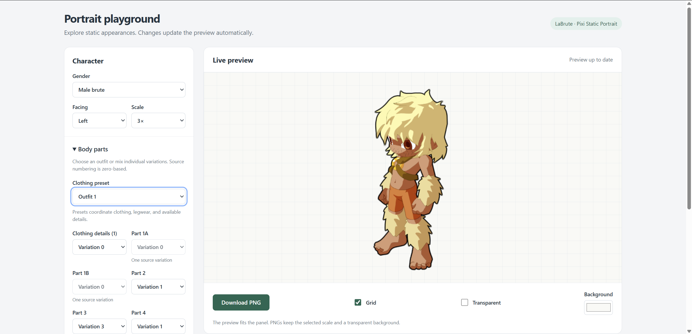

# LaBrute Pixi Static Portrait



Static LaBrute portraits for an initialized, caller-owned PixiJS 8 renderer.

```sh
npm install labrute-pixi-static-portrait pixi.js
```

## Static API

```ts
import { BruteDisplay, clearPortraitCache } from 'labrute-pixi-static-portrait';
import type { BodyParts, PortraitColors } from 'labrute-pixi-static-portrait';
import type { Renderer } from 'pixi.js';

async function portrait(renderer: Renderer, parts: BodyParts, colors: PortraitColors) {
  const display = new BruteDisplay({
    renderer,
    gender: 'female',
    parts,
    colors,
    facing: 'left',
    scale: 3,
    highlightColorName: 'col3', // optional white selection outline
  });
  try {
    await display.ready;
    return await renderer.extract.image({ target: display.container, format: 'png' });
  } finally {
    display.destroy();
  }
}

// When retiring a pooled renderer, after destroying its displays:
// clearPortraitCache(renderer);
// renderer.destroy();
```

Decode application body/color strings before construction. The package takes these plain values:

| Field | Values |
| --- | --- |
| `gender` | `'male' \| 'female'` |
| `parts` | Nonnegative integer `p1`, `p1a`, `p1b`, `p2`, `p3`, `p4`, `p5`, `p6`, `p7`, `p7b`, `p8` |
| `colors` | `#rrggbb` strings for `col0`, `col0a`, `col0c`, `col1`, `col1a`, `col1b`, `col1c`, `col1d`, `col2`, `col2a`, `col2b`, `col3`, `col3b`, `col4`, `col4a`, `col4b` |
| `facing` | `'left'` by default; `'right'` mirrors the authored portrait around its origin |
| `scale` | Positive finite display scale, default `1`; production extraction uses `3` |
| `highlightColorName` | Optional color slot with a white selection outline |
| `presentation` | Default `true`: strokes at least one native portrait pixel wide, black outer outline, and optional highlight. Set `false` for source fidelity captures. |
| `recolorIrises` | Default `true`: bind verified turquoise iris fills to `col3`. Set `false` for unmodified source eyes. |

Selectors wrap modulo each selected child timeline's **complete** frame count, including empty frames. Other nested timelines remain at frame zero. The root stays at its initial portrait frame.

`container` is stable across updates. `ready` is the latest update's `Promise<void>`. `svgs` exposes source sprites for diagnostics; cached color groups retain their source sprites under hidden `source-sprites` containers with the same transforms. Treat these objects and exported definitions as read-only.

```ts
await display.updateAppearance({ ...display.appearance, gender: 'male', parts, colors });
await display.setColors({ ...colors, col3: '#bb1111' }, 'col3');
display.destroy(); // safe to call repeatedly, including before readiness
```

Updates stage a new tree and commit atomically. Asset or validation failures reject; an existing committed tree stays visible. Superseded updates and destruction reject pending promises with `AbortError`. A stale load cannot replace a newer appearance or create late sprites. `destroy()` releases staged resources immediately without waiting for network completion.

There is no owned Application, canvas, renderer pool, queue, PNG cache, ticker, or animation loop. Rendering/extraction happens through the caller's renderer. Construction and appearance updates may render cached color textures; idle displays perform no work. Changing external parent scale after readiness does not rerasterize SVGs: pass the intended scale through the API and update again after changing renderer resolution.

## Texture ownership

Definition indexes and frame plans are shared. Only the selected appearance's SVGs load. Compatible base SVG load promises are shared through the consumer's Pixi `Assets` cache. Additive colored textures and selected colored groups are cached per renderer and rasterization resolution, with reference-counted borrowers.

Idle caches are bounded to 256 base entries / 32 MiB globally and 128 variants / 32 MiB per renderer; active borrowers are never evicted. Base textures already present in the consumer's Assets cache are treated as externally owned. Package-loaded idle bases may be unloaded when the limits are exceeded. `clearPortraitCache(renderer)` releases idle variants when retiring a renderer; call it after destroying its displays. The package never destroys a renderer. `portraitCacheStats(renderer)` reports cache ownership and estimated RGBA bytes.

## Generate from the static SWF

Prerequisites: Node 20+, Java 17+, and PowerShell `Expand-Archive` on Windows or `unzip` elsewhere. Browser validation uses Node 22+ (global WebSocket) and an installed Chromium browser; CI uses Node 24.

```sh
npm ci
npm run setup:swf
npm run export:swf
npm run test:generation
npm run build
npm test
npm run test:browser
npm run test:comparison
npm run test:playground
npm run benchmark
npm pack --dry-run --json
```

`setup:swf` downloads FFDec **26.4.0** and verifies its archive SHA-256. Export also verifies the JAR checksum, including when `FFDEC_JAR` points to another installation. SWF display lists are decoded directly; FFDec exports vector SVG artwork. [Source provenance](src/swf/manifest.json) records the SWF hash, exporter, generator hashes, root mapping, and all timeline frame counts.

The source is `src/swf/perso.swf`, a separate dataset from the fighter package. Symbol753's `sub` placements verify male **Symbol460** and female **Symbol752**. Definitions retain all source frames; the portrait API selects only the required initial/decoded frames. Selectors and effects belong to placements, repeated placements/frames share references, and SVG hair/eye strokes use FFDec's authored-width metadata plus a one-native-portrait-pixel presentation minimum that scales with display size and renderer resolution. Source fidelity captures retain a one-texture-pixel raster minimum. Raster resolution includes composed transforms, display scale, and renderer resolution.

Symbol45 is a source clip mask at depth 5 through 8 in Symbol57, rather than a generally hidden asset. Masks remain siblings in shared timeline space. Zero-alpha color transforms are retained. Colors use Flash additive offsets instead of blanket tint. Turquoise eye shapes **337/344** were verified in this source; their iris paths alone receive `col3`, preserving whites and outlines.

## Playground and fidelity

```sh
npm run build
npm run playground
```

Open `http://localhost:3001`. The playground imports the public `BruteDisplay` and accepts the same appearance strings as the fighter playground: **11 hexadecimal body digits** and **32 decimal color digits** (two palette-index digits per color slot). Complete inputs apply automatically; incomplete edits leave the last valid portrait visible. Individual body controls update the body string. Color pickers can override the imported palette without changing the last imported color string.

The playground also supports source-derived body choices and coordinated outfits, both genders, facing, scale, highlights, background previews, and transparent PNG download. Basic/detailed presets are deduplicated by checking source placements across body builds. String decoding lives in `test/appearanceStrings.mjs`; the package API continues to accept decoded appearance objects.

Source comparison renders frozen original SWF vector records in **local Ruffle**, with matching origin, facing, scale, colors, and selectors. It provides side-by-side images, overlay, differences, and downloadable appearance-case reports. Frozen references explicitly apply decoded appearance and frame choices; they **do not execute the full original ActionScript decoder**. Geometry captures disable presentation outlines/highlights and iris enhancement; those effects have separate browser checks.

Current twelve-case comparisons have 9.49-12.92% differing occupied pixels at a 24/255 threshold, concentrated on antialiased edges and thin strokes. This is a measured rasterizer difference, not pixel-exact Flash reproduction. See [validation and performance](docs/validation.md) and the [comparison report](docs/comparison-results.json). No missing source artwork was encountered. WebGL is validated; WebGPU and Canvas backends have not been validated. The generic source glow approximation is retained for decoded effects, although this static SWF uses blur records only.

## Source formatting

Run `npm run format` to format maintained renderer code, scripts, tests, playground markup, and build/workflow configuration. `npm run format:check` checks those same files. Control-flow blocks, logical sections, and ownership-sensitive code use explicit braces, line breaks, and comments.

Generated symbol/JSON/SVG sources retain the generator's readable formatting. Compiled files in `dist` are rebuilt rather than hand-edited, and the published shared symbol dataset remains minified.

## Package and release

Native ESM and CJS renderer entries import their matching consumer Pixi runtime. Conditional exports select `.d.mts` or `.d.cts` declarations. One minified, Pixi-free `symbol-data.cjs` is shared by both entries. Maintained/generated sources remain readable. All 481 previous named symbol exports are retained; the regenerated source additionally exports shape wrappers and other source definitions.

The data types changed: definitions are read-only, SVGs use `offset` with no correction `scale`, placements carry `partIdx` / `colorIdx`, sparse `colorTransform`, masks and effects. The obsolete symbol-level selector fields, placement `type`, `colorOffset`, and truthiness-based alpha handling are removed. Applications should migrate to the decoded portrait API rather than keep an old renderer.

For a local publication, including creating the renamed npm package, run:

```sh
npm run deploy
```

This uses your npm login and runs the build and tests through `prepublishOnly`.
The GitHub release workflow adds `--provenance` when publishing from its hosted runner.
Do not pass that flag locally: automatic provenance generation requires a supported CI identity.
See [npm's provenance requirements](https://docs.npmjs.com/generating-provenance-statements/).
